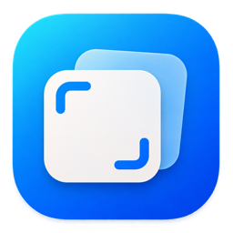
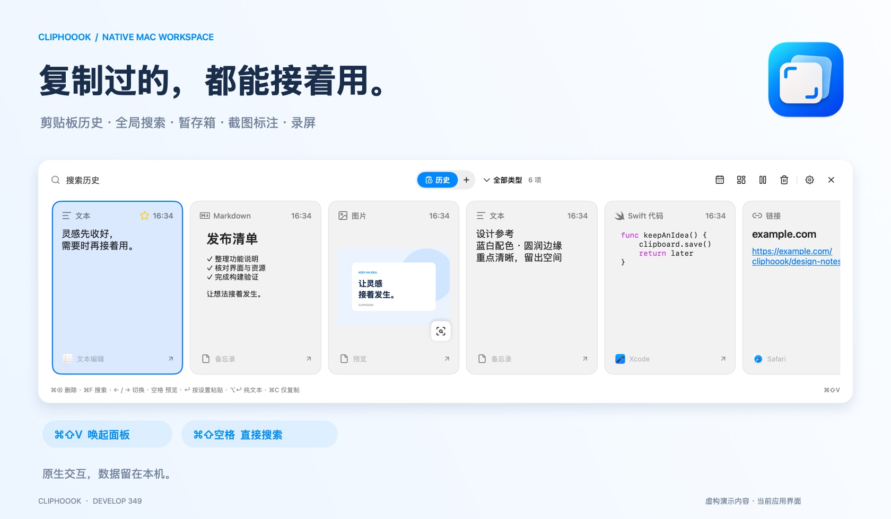
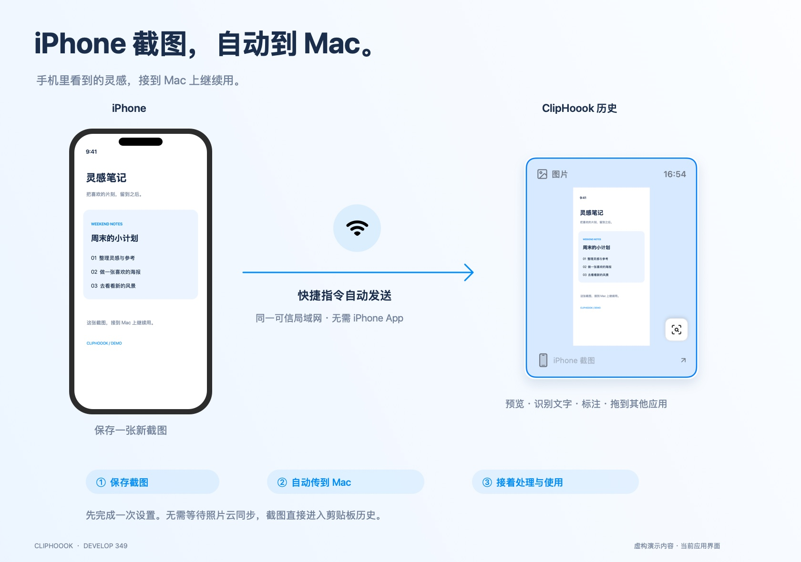
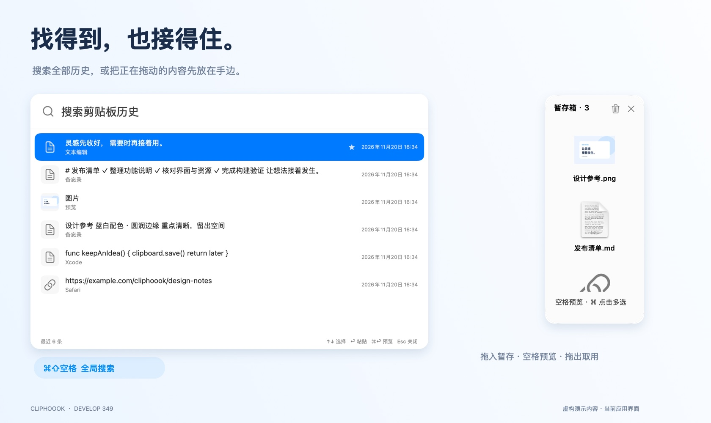
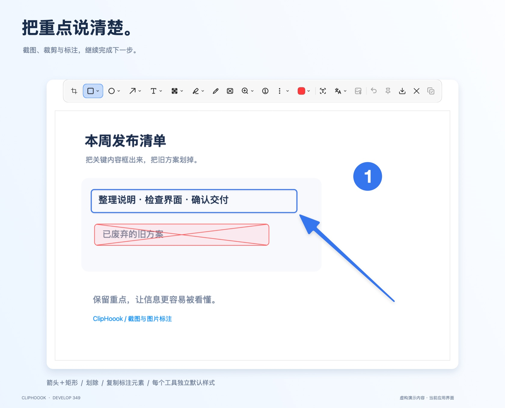

<p align="center">
  
</p>

<h1 align="center">ClipHoook</h1>
<p align="center"><strong>让复制、截图与文件流转，接着发生。</strong></p>
<p align="center">一款原生 macOS 效率工具，把剪贴板历史、全局搜索、暂存箱、截图标注和录屏放在手边。</p>
<p align="center">macOS 14+ · SwiftUI / AppKit · 本机保存 · 开发版 1.0.0（349）</p>
<p align="center">
  <a href="#下载与安装">下载</a> · <a href="#iphone-截图自动到-mac">iPhone 传图</a> · <a href="#功能一览">功能一览</a> · <a href="#常用快捷键">快捷键</a> · <a href="#构建与验证">构建与验证</a> · <a href="#文档导航">详细文档</a>
</p>



> 当前功能代码位于 [develop](https://github.com/rzllovezwl/shitie-mac/tree/develop)。配图使用当前开发版界面与虚构演示内容生成。这里介绍 349 构建，已导出的商店候选使用各自独立的源码快照与功能说明。

## 下载与安装

| 下载方式 | 适合谁 | 入口 |
| --- | --- | --- |
| App Store 正式版 · 1.1.0 | 希望通过商店安装和更新 | [在 Mac App Store 中获取](https://apps.apple.com/cn/app/id6823468334) |
| GitHub 开发预览版 · 349 | 想体验当前开发功能，Apple 芯片与 Intel 通用 | [下载应用 ZIP](https://github.com/rzllovezwl/shitie-mac/releases/download/v1.0.0-dev.349/ClipHoook-dev-349-universal.zip) · [更新说明](https://github.com/rzllovezwl/shitie-mac/releases/tag/v1.0.0-dev.349) |

GitHub 下载版已使用 Developer ID 签名并通过 Apple 公证。下载后双击解压，将「ClipHoook测试版.app」拖入“应用程序”后打开，支持 macOS 14 及以上。[发布页](https://github.com/rzllovezwl/shitie-mac/releases/tag/v1.0.0-dev.349)同时提供校验值与安装说明。App Store 与 GitHub 版本的功能和版本号可能不同，请查看各自的更新记录。[下载与分发说明](https://github.com/rzllovezwl/shitie-mac/blob/develop/docs/Downloads.md)

## 功能一览

| 你正在做什么 | ClipHoook 可以接着做 |
| --- | --- |
| 复制文字、链接、图片或文件 | 自动保留历史，记录来源、日期与次数，随时预览和再次使用 |
| 在 iPhone 上看到想留存的内容 | 保存截图后通过快捷指令传到 Mac，在 ClipHoook 中预览、识别、标注和使用 |
| 找回之前复制的内容 | ⌘⇧空格全局搜索，按关键词、文件名、来源或图片中的文字查找 |
| 在多个应用之间搬运内容 | 拖入屏幕侧边的暂存箱，再拖到目标应用，成功投放后移除暂存项 |
| 截取并说明一块画面 | 区域、窗口、整屏、长截图，接着裁剪、标注、识别文字或翻译 |
| 录下操作过程 | 录区域、窗口或整屏，暂停继续，结束后预览、裁剪时长并确认保存 |
| 对照图片工作 | 把图片钉在桌面，调整大小与透明度，工具条悬浮在图片上方 |
| 确认刚才复制成功了 | 菜单栏两张卡片交错 0.35 秒，搭配十种可选提示音 |

### 复制过的，随时找回

剪贴板面板支持文字、网页链接、图片、RTF/HTML/RTFD 富文本和本机文件引用。代码的缩进与换行按原样保留，相同内容再次复制会更新最近时间和复制次数。面板可从鼠标所在显示屏的上、下、左、右侧出现，支持紧凑、标准、宽敞布局和系统、浅色、深色外观。

单击选中，空格预览，⌘ 点选或 ⇧ 连选多项。卡片可拖动排序、钉在面板前部、收藏到自定义分类，也可用 ⌘G 成组或 ⌘⇧G 取消成组。外部应用一次复制多项时可自动成组，保留成员顺序。搜索、类型、收藏与日历日期可以组合筛选。

文字卡片支持 ⌘E 编辑。图片预览支持双指缩放、OCR、翻译、标注、另存为和钉到桌面。文件预览按类型使用原生音视频播放器或快速查看，PDF、Office 文档等的显示能力由 macOS 和已安装扩展提供。右下角的来源按钮可返回来源应用。

文件默认保存位置引用和访问书签，用户可在详情中明确“保存副本”。原文件移动、删除或权限失效时会提示重新关联。微信多项复制中无法读取的图片会保留缺图占位和顺序，避免把不完整分组当成完整内容投放。文件与富文本细节见 [数据说明](https://github.com/rzllovezwl/shitie-mac/blob/develop/docs/Stage2.md)。

“图片”包含所有图片，“屏幕截屏”“ClipHoook截图”和“iPhone 截图”可分别筛选，来源不明确的旧图片可手动更正。日历可按月、年和今天定位，数字对应当前筛选下的记录，同一内容的多个复制日期共用内容文件。旧记录仅能回填首次和最近日期，已清理内容无法通过日历恢复。

### iPhone 截图，自动到 Mac



手机上看到一段资料、一张灵感图或一段聊天内容，截屏保存到照片，就能通过快捷指令送进 Mac 的 ClipHoook 历史。接着按空格预览、识别文字、翻译、标注、钉在桌面，或拖进正在使用的应用。

先在 Mac 开启接收，用 iPhone 扫码添加模板、填入自己的接收地址并开启“立即运行”。之后在同一可信局域网内，Mac 保持运行和接收开启，新截图便可自动送达。整个过程无需安装 iPhone App，也无需等待 iCloud 照片同步。

| ① 设置一次 | ② 手机保存截图 | ③ Mac 接着用 |
| --- | --- | --- |
| 开启接收，添加模板，启用自动化 | 在同一可信局域网中自动发送 | 预览、OCR、翻译、标注、拖放 |

[查看图文设置指南](https://github.com/rzllovezwl/shitie-mac/blob/develop/docs/iPhoneScreenshots.md) · [添加 iCloud 快捷指令模板](https://www.icloud.com/shortcuts/92f7bdc3a5554d1e9d560e0ed03a8879)

手机与 Mac 需能在局域网中互相访问，Mac 休眠或离网时不会送达，当前没有离线补传。传输使用带随机配对码的本地 HTTP 地址，请在可信网络中使用，并保留自己的接收地址。

### 搜索与暂存，少一次来回切换



**全局快速搜索**默认 ⌘⇧空格唤起。空查询展示最近 10 条，输入后搜索全部保留历史，包括图片 OCR 和组内内容。用方向键选择，⌘↩ 预览，回车按开发版的粘贴设置使用结果。图片识别在本机后台逐步补充，关闭搜索后停止排队。独立搜索窗保留原剪贴板面板的筛选与滚动位置。[搜索操作说明](https://github.com/rzllovezwl/shitie-mac/blob/develop/docs/QuickSearch.md)

**暂存箱**在拖动文件、图片、文字或链接时出现在鼠标附近的屏幕侧边。单列缩略图可上下滚动，文件名放在图标下方，移除按钮仅在悬停时出现。内容拖入后保持显示，空箱自动隐藏。两指向屏幕侧滑动可收成小边缘，点击再次展开。支持多选、空格预览、OCR 和翻译。目标应用接受拖出内容后移除对应暂存项，系统取消或拒收时保留，原文件始终保留。[暂存箱操作与兼容性](https://github.com/rzllovezwl/shitie-mac/blob/develop/docs/StagingShelf.md)

### 截图、标注，把重点说清楚



⌥A 进入截图，可点选窗口或拖出区域，⌥W 截取整个屏幕，⌘⇧D 进入长截图。冻结取景时使用进入截图时的屏幕与窗口快照，避免点击视频窗口后换成后续画面。窗口阴影可选，选区完成后继续标注。编辑已有图片或文字时也能发起新截图。

标注支持矩形、椭圆、箭头、箭头＋矩形、文字、数字、荧光笔、画笔、钢笔、马赛克、背景模糊、区域高亮、放大镜和贴图，并提供裁剪。矩形、椭圆和圆尾箭头带柔和阴影。组合箭头指向矩形圆角并留出间距，拖箭尾和框角分别调整。独立的“划除”工具用于标记弃用区域，默认 X、线宽 2 点，叉号与边框使用相同线宽和 80% 不透明度。

标注元素支持复制粘贴、按住 Option 拖动复制、移动和缩放，保存后可继续编辑。设置中可为支持颜色和线宽的绘制工具分别配置默认样式。文字提供描边和底色，放大镜提供玻璃镜框，贴图可来自剪贴板图片或本地文件。[完整标注说明](https://github.com/rzllovezwl/shitie-mac/blob/develop/docs/ScreenshotAnnotations.md)

图片与文字可在本机识别和翻译。⇧⌘A 截图后直接 OCR，⇧⌥A 截图后直接翻译，处理中显示可取消的扫描反馈。macOS 15 起支持应用内语言选择和图片覆盖翻译，14.4 起可在文字预览使用系统翻译弹窗，14.0–14.3 会提示版本要求。首次使用语言组合可能需要下载系统语言资源。

### 录完先预览，确认后保存

⌥R 选择区域、窗口或整屏，绿色实心三角开始，红色实心方块结束。默认不倒计时、30 fps、省空间（最高 1080p）、系统声音开启、麦克风关闭、显示鼠标与点击光圈。支持原始清晰度、60 fps、暂停继续、麦克风选择和隐藏控制条。

结束后进入待保存预览，使用原生播放控件和首尾裁剪调整时长。点击“保存…”并确认位置后导出 MP4/H.264 与 AAC 音轨，同时加入历史。关闭预览会保留片段与裁剪范围，可从菜单栏继续，点击“放弃”才删除内部片段。当前裁剪针对视频时长。[录屏、保存与恢复说明](https://github.com/rzllovezwl/shitie-mac/blob/develop/docs/ScreenRecording.md)

### 按你的习惯，轻一点或清脆一点

“通用 → 声音”提供双咔嗒（默认）、轻扣、木叩、气泡、金属轻敲、金属双击、金属弹片、纸张翻页、纸张轻揉和原提示音。选择后立即播放，也可单击“试听”重播，日常提示音可独立关闭。349 的播放音量为 85%，实际响度随系统输出音量变化。音效随应用本地打包。[音效资源与设置](https://github.com/rzllovezwl/shitie-mac/blob/develop/docs/CopySounds.md)

桌面贴图支持拖动、缩放滑杆、1∶1 和透明度滑杆，半透明工具条显示在图片上方，空间不足时调整位置。菜单栏、设置、Dock 与访达使用统一的 B 方案叠卡标识。[图标与品牌资源](https://github.com/rzllovezwl/shitie-mac/blob/develop/docs/Branding/B-325/README.md)

## 常用快捷键

以下为开发版默认值，可在“设置 → 快捷键与权限”中修改。面板、预览、文字输入和标注会按当前操作上下文分配按键。

| 操作 | 快捷键 |
| --- | --- |
| 唤起／收起剪贴板面板 | ⌘⇧V |
| 唤起／收起全局快速搜索 | ⌘⇧空格 |
| 面板搜索／预览 | ⌘F / 空格 |
| 复制／复制纯文本 | ⌘C / ⌘⇧C |
| 按设置粘贴／纯文本粘贴 | ↩ / ⌥↩ |
| 编辑文字／标注图片 | ⌘E |
| OCR／翻译 | ⌘W / ⌘B |
| 收藏／钉住面板卡片 | ⌘D / ⌘⇧T |
| 钉住桌面图片／图片另存为 | ⌘T / ⌘S |
| 成组／取消成组 | ⌘G / ⌘⇧G |
| 删除所选（确认后） | ⌘⌫ |
| 区域或窗口截图／整屏截图 | ⌥A / ⌥W |
| 长截图 | ⌘⇧D |
| 截图后 OCR／截图后翻译 | ⇧⌘A / ⇧⌥A |
| 开始或结束录屏／暂停或继续 | ⌥R / ⌥⇧R |

标注内的工具键为矩形 R、椭圆 O、箭头 E、文字 T、画笔 L、遮盖 M、钢笔 P、划除 X。输入文字时保留系统文字编辑行为。全局唤起键冲突时可从菜单栏打开，更改注册失败时保留原设置，应用也会定期重试。

## 数据与系统要求

适用于 macOS 14 Sonoma 及以上。macOS 26 起使用原生玻璃，旧系统使用系统磨砂材料，新翻译框架按系统版本弱链接。最低系统与框架加载在构建检查中验证，Sonoma 实际桌面交互仍需实机确认。

历史默认保存 7 天，可选 1 天、15 天、30 天、半年或永久。总存储量默认不限，可手动设置上限，超出后从最早可清理记录开始删除。收藏长期保留并保护收藏组成员，手动删除或清空仍需确认。单张历史图片上限 15 MB，单条文字 32 MB，单份富文本 15 MB。暂存箱独立限制为 100 项，内置图片与文字合计 128 MB，单图 32 MB / 4000 万像素，单段文字 2 MB。

历史元数据使用 SQLite，内容、富文本、书签和明确保存的副本保存在本机 Application Support。暂存箱、桌面贴图和待保存录屏各自持久化。应用不提供账号、云同步、广告或分析 SDK。OCR 与翻译使用系统能力，iPhone 接收仅在用户开启时监听局域网。

旧 JSON 迁移前保留完整备份，未关联文件进入恢复目录，备份与恢复空间单独显示并由用户明确删除。清空历史会删除应用保存的记录，系统当前剪贴板与被引用的原文件保持原样。来源应用按剪贴板变化时的前台应用推断，后台写入的实际来源可能无法准确识别。[迁移与历史基础](https://github.com/rzllovezwl/shitie-mac/blob/develop/docs/Stage0.md)

## 构建与验证

用本机 Xcode 27 打开 [ClipboardShelf.xcodeproj](https://github.com/rzllovezwl/shitie-mac/tree/develop/ClipboardShelf.xcodeproj)，选择「ClipHoook测试版」与“我的 Mac”。⌘R 构建并运行，⌘B 只构建。首次构建需配置自己的开发团队与签名。Debug 产物在 build/ClipHoook测试版.app，Bundle ID 为 com.renzhenglin.shitie.dev。

```sh
git switch develop

xcodebuild -project ClipboardShelf.xcodeproj \
  -scheme ClipHoook测试版 -configuration Debug \
  -destination 'platform=macOS' build

# 检查已构建的开发包及各功能代码回归
zsh Tools/VerifyTestBuild.sh

# 核验通过后另存版本号测试包，已有同名包会保留
zsh Tools/PackageTestBuild.sh
```

工程源描述位于 [project.yml](https://github.com/rzllovezwl/shitie-mac/blob/develop/project.yml)，修改工程时同步生成的 Xcode 工程。每次交付新测试版递增 Info.plist 构建号，并在 [ReleaseHistory.json](https://github.com/rzllovezwl/shitie-mac/blob/develop/ClipboardShelf/Resources/ReleaseHistory.json) 顶部补充同版更新记录。Xcode 自动校验，设置里的版本记录读取同一资源。本次 GitHub 文档同步沿用已验证的 349 构建。

349 的开发签名构建与 VerifyTestBuild.sh 回归已通过，覆盖存储、多选排序、搜索、暂存箱、截图像素、标注编辑、录屏时间轴与导出，以及十种音效的解码和偏好设置。构建和代码测试的通过情况与桌面实际效果分别记录，声音质感、真实拖放、权限、多屏和音视频设备由用户在应用中确认。

Debug / Release 使用开发身份，自动粘贴需系统键盘事件授权。拒绝后可复制，再在目标应用手动 ⌘V。更换应用路径、Bundle ID 或签名身份可能影响已有权限，测试时应核对实际运行的版本和路径。

商店版本使用正式 Bundle ID com.renzhenglin.shitie 和沙盒配置。最近保留的候选为 **2.0.0（12）**，基于开发 338 的独立快照，已去掉自动粘贴。当前 develop 仍保留开发版自动粘贴，直接切换 AppStore scheme 不能代替该快照的功能裁剪。上架包、归档与签名文件保留在本机，审核状态以 App Store Connect 为准。[发布与历史候选说明](https://github.com/rzllovezwl/shitie-mac/blob/develop/docs/AppStore.md)

## 文档导航

| 文档 | 内容 |
| --- | --- |
| [全局快速搜索](https://github.com/rzllovezwl/shitie-mac/blob/develop/docs/QuickSearch.md) | 匹配范围、键盘操作、图片 OCR 与焦点交接 |
| [暂存箱](https://github.com/rzllovezwl/shitie-mac/blob/develop/docs/StagingShelf.md) | 拖入拖出、收起展开、文件引用、预览及拖放兼容性记录 |
| [截图与标注](https://github.com/rzllovezwl/shitie-mac/blob/develop/docs/ScreenshotAnnotations.md) | 工具、组合箭头、划除、裁剪、元素复制与默认样式 |
| [录屏](https://github.com/rzllovezwl/shitie-mac/blob/develop/docs/ScreenRecording.md) | 默认设置、点击动画、时长裁剪、待保存片段与导出 |
| [复制提示音](https://github.com/rzllovezwl/shitie-mac/blob/develop/docs/CopySounds.md) | 十种音效、试听切换、本地资源及检查方式 |
| [iPhone 截图接收](https://github.com/rzllovezwl/shitie-mac/blob/develop/docs/iPhoneScreenshots.md) | 局域网配对、快捷指令与连接排查 |
| [历史基础](https://github.com/rzllovezwl/shitie-mac/blob/develop/docs/Stage0.md) / [面板键盘操作](https://github.com/rzllovezwl/shitie-mac/blob/develop/docs/Stage1.md) / [富文本与文件](https://github.com/rzllovezwl/shitie-mac/blob/develop/docs/Stage2.md) | 数据结构、迁移、历史功能及验证记录 |
| [界面图标](https://github.com/rzllovezwl/shitie-mac/blob/develop/docs/Iconography.md) / [B 方案 Logo](https://github.com/rzllovezwl/shitie-mac/blob/develop/docs/Branding/B-325/README.md) | 矢量图标、品牌母版与生成方式 |
| [支持与常见问题](https://github.com/rzllovezwl/shitie-mac/blob/develop/distribution/web/support.md) | 面向用户的操作帮助 |
| [Git 分支约定](https://github.com/rzllovezwl/shitie-mac/blob/develop/docs/Git.md) / [上架说明](https://github.com/rzllovezwl/shitie-mac/blob/develop/docs/AppStore.md) / [商店资料](https://github.com/rzllovezwl/shitie-mac/blob/develop/distribution/metadata/zh-Hans/README.md) | 开发、版本记录、已保留候选与审核资料 |

开发分支 develop 用于日常迭代，main 保留发布基线。配图使用隔离演示数据生成，方法见 [首页配图说明](docs/images/README.md)。源码、资源、验证工具与说明随 GitHub 同步，已签名并公证的安装包通过 Releases 分发。其余构建归档、证书私钥、签名配置和个人剪贴板数据保留在本机。
