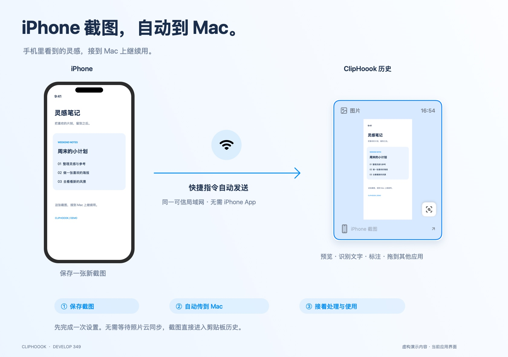
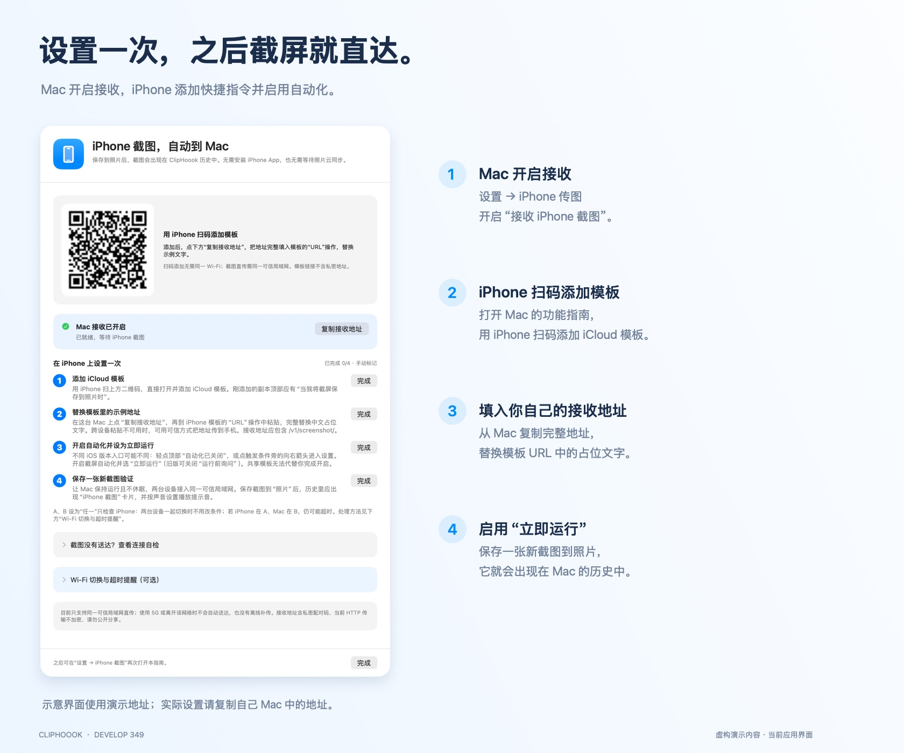

# iPhone 截图，自动到 Mac

在手机上留住资料、灵感或聊天中的一块内容，Mac 上接着预览、提取文字、翻译、标注或拖进其他应用。以下介绍当前开发版 1.0.0（349），具体版本功能请以应用内记录为准。

适用于 iPhone 快捷指令中能看到“截屏／已保存截屏时”自动化触发器的系统。此功能使用手机与 Mac 之间的局域网，不需要安装 iPhone App，也不依赖 iCloud 照片同步。

新安装 ClipHoook 首次启动时会显示设置指南。已有用户可点击剪贴板面板中的“iPhone 截图直达”介绍卡片，或从“设置 → iPhone 传图 → 查看功能介绍与设置步骤…”再次打开。指南中的四步可手动标记完成；排障和 Wi-Fi 说明按需展开。介绍卡片会保留到手动点击右上角的 ×；关闭卡片不会关闭截图接收。

## 四步完成设置

| 步骤 | 在哪里做 | 要完成的操作 |
| --- | --- | --- |
| 1 | Mac | 设置 → iPhone 传图，开启接收 |
| 2 | iPhone | 扫描 Mac 指南中的二维码，添加 iCloud 模板 |
| 3 | iPhone | 将自己 Mac 的接收地址完整填入模板 URL |
| 4 | iPhone | 启用自动化并设为“立即运行”，保存一张新截图验证 |

配图采用虚构示例，二维码指向公开模板，不含个人接收地址。实际配对时请复制自己 Mac 中的完整地址。

## Mac 端

1. 运行 ClipHoook，打开“设置 → iPhone 传图”。
2. 开启“接收 iPhone 截图”，确认状态为“已就绪，等待 iPhone 截图”。
3. 点“查看功能介绍与设置步骤”，用 iPhone 扫描二维码直接打开 iCloud 模板。点击 Mac 上的“复制接收地址”，稍后填入模板。接收地址末尾含随机配对码，不要公开分享；Mac 需保持运行。

## iPhone 端

1. 扫描 Mac 指南中的二维码，直接打开并添加 iCloud 模板。导入后打开副本，确认顶部有“当我将截屏保存到照片时”；旧的 `.shortcut` 下载文件可能不保留触发条件。
2. 把从 Mac 上复制的接收地址粘贴到模板的“URL”操作中，完整替换中文占位文字。如果跨设备粘贴不可用，可通过自己信任的方式把地址传到 iPhone。上传地址应包含 `/v1/screenshot/`。
3. 不同 iOS 版本入口可能不同：轻点顶部“自动化已关闭”，或点触发条件旁的向右箭头进入设置。启用截屏自动化并设为“立即运行”（旧版可关闭“运行前询问”）。iPhone 导入的共享模板不会代替用户启用自动化；这一步只需设置一次，并保持启用。
4. 保存一张新截图到“照片”。ClipHoook 历史中应出现来源为“iPhone 截图”的图片卡片，并按声音设置播放提示音。第一次运行若系统询问本地网络或快捷指令访问权限，允许后再试一次。

如果手动运行模板时显示请求超时，检查 Mac 接收状态和两台设备的局域网连接；若手动发送成功而自动运行失败，确认模板顶部不再显示“自动化已关闭”，且运行方式为“立即运行”。

## 截图到达 Mac 后

来源为“iPhone 截图”的卡片可与其他图片一样使用。单击后按空格预览，⌘W 识别图片文字，⌘B 翻译，⌘E 打开标注，⌘T 钉在桌面，或直接拖进其他应用。也可在面板类型菜单中选择“iPhone 截图”集中查看。

## 重置接收配对码

如果完整接收地址意外泄露，或想断开旧 iPhone，在 Mac 的“设置 → iPhone 传图”点击“重置接收配对码…”，阅读影响后确认。原地址会失效，历史记录不受影响。随后重新复制新地址，完整替换每台仍要使用的 iPhone 模板中“URL”操作的旧地址，再保存一张新截图验证。指南中的第 2、4 步会恢复为未完成，便于核对。不要把完整地址公开分享；本地 HTTP 传输仍不加密。

## 减少离开局域网后的超时提醒

这个筛选可选。它只检查 **iPhone** 当前的 Wi-Fi 名称，不知道 Mac 正连接哪个网络。若 iPhone 在 A、Mac 在 B，且两个网络不能互访，“A 或 B”仍会执行上传并弹出超时提示。

**立即消除提示：**让两台设备连接同一可互访的 Wi-Fi；暂时做不到时，在 iPhone 上关闭这条截图自动化，回到同网再开启。如果 Mac 长期固定在 B，可以把下面的“如果”只保留 B：iPhone 在 A 时跳过发送。仅当两台设备通常一起在 A、B 间切换时，才同时允许 A 和 B。

1. 在“获取 URL 内容”之前，添加“获取网络的详细信息”，选择“无线局域网”的“名称”。记下 iPhone 显示的常用网络名称 A 和 B。
2. 紧接着添加“如果”，先设为“网络的详细信息 是 A”。轻点“如果”中的“＋”添加条件，再设“网络的详细信息 是 B”，把条件关系选为“任一”。如果已经设置了 A，从添加 B 条件开始即可。
3. 把唯一的“获取 URL 内容”移到“如果”分支，“否则”保持空白；截屏触发器、获取截图和 URL 地址保持原样。
4. 分别让两台设备同在 A、同在 B 时保存截图验证：这两种情况可尝试送达；蜂窝网络应跳过网络请求。若手机 A、Mac B 且两网不互通，仍会超时。被跳过的截图不会自动补传。

仅将 Mac 可从 iPhone 访问的可信网络加入条件。这个判断只筛掉其他 Wi-Fi 和蜂窝网络，不能比较两台设备当前的 Wi-Fi；即使名称匹配，Mac 休眠、接收服务未运行、地址变化或访客网络隔离时仍可能超时。当前模板无法在 A/B 不同网时同时做到自动识别 Mac 网络和静默跳过。

## 使用边界

- 手机和 Mac 应连接同一可信局域网；部分访客网络会禁止设备互访。
- Mac 休眠、退出 ClipHoook、暂停记录、接收开关关闭或局域网地址变化时，截图不会被自动接收；当前版本没有离线队列。
- 单张图片最多 15 MB。重复送达的相同图片不会生成重复卡片，也不会增加复制次数。
- 成功收到一张新截图时，Mac 会按“设置 → 声音”的开关播放提示音；重复图片不会再次响铃。
- 当前传输使用 HTTP；随机配对码限制谁能发送，但无法加密传输。避免在不可信 Wi-Fi 上开启，也不要分享完整接收地址。
